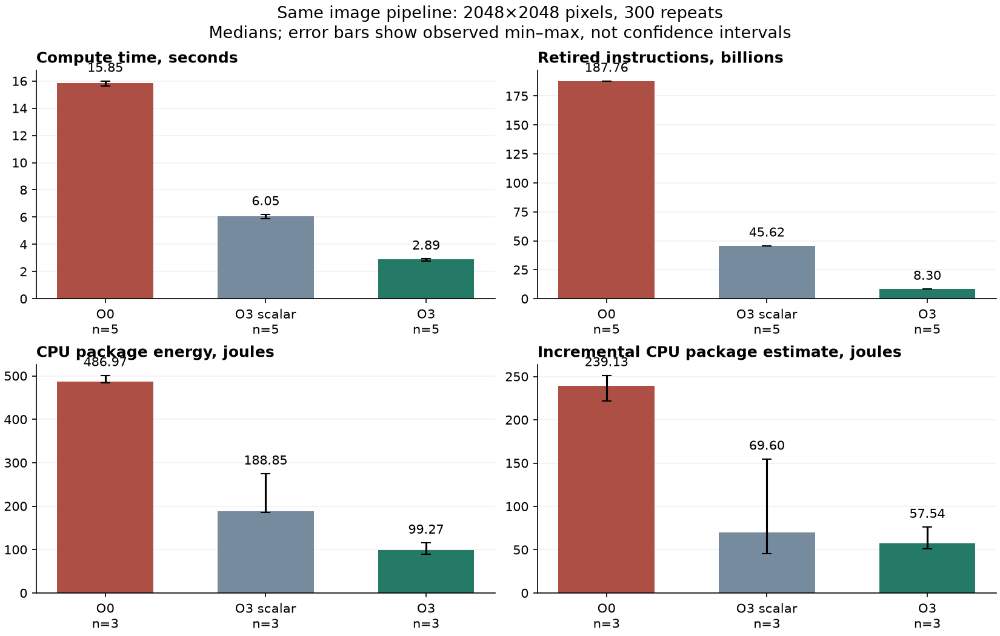

# Лабораторна №2. Вимірювання й аналіз продуктивності

## Мета та основний результат

Досліджено власну однопотокову C++17 програму обробки зображення до й після оптимізації компілятором. На однаковому навантаженні медіана часу обчислювального циклу зменшилася з **15,8489 с для O0 до 2,8938 с для O3**, тобто отримано **5,48× прискорення**. Відносно оптимізованого скалярного контролю O3-scalar виграш становив **2,09×**. Результати перевірені однаковою контрольною сумою, незалежним еталонним обчисленням на малих входах та санітайзерами.

Ці числа характеризують конкретні збережені запуски в WSL2. O0 є навчальною базовою версією, тому результат 5,48× не слід переносити на вже оптимізовані програми. Нижче окремо розглянуто часові джерела, апаратні лічильники, вибіркові CPU-профілі та межі енергетичного вимірювання.



## Програма, середовище та відтворюваність

Програма послідовно виконує три стадії: зважене RGB → grayscale, підвищення контрасту з насиченням у межах `0…255` і горизонтальний п’ятиточковий фільтр із вагами `1, 4, 6, 4, 1`. Після проходу результат стає червоним каналом наступної ітерації; початкові G і B залишаються фіксованими. Так створюється справжня залежність між повтореннями, а не багато незалежних копій однакової роботи. Формули, межі арифметики та генератор наведено в [PROGRAM.md](PROGRAM.md); вихідний код — у [src/](../src/).

| Умова | Значення |
|---|---|
| Хост | Windows 11 Pro; Intel Core i5-10500, 6 фізичних ядер / 12 логічних CPU, близько 32 GiB RAM |
| Linux | Ubuntu 24.04, WSL2, ядро `6.6.87.2-microsoft-standard-WSL2` |
| Компілятор | GCC 13.3.0 |
| Основне навантаження | `2048 × 2048`, 300 повторень, `seed = 12345` |
| Час і perf stat | 5 запусків кожної версії; змінний прямий/зворотний порядок |
| Прив’язка | `taskset -c 0`, один потік |
| Профілі | Один окремий запис кожної версії; `cpu-clock:u`, цільові 199 Гц, `--call-graph dwarf,16384` |
| Кінцева контрольна сума | `582320370857612868` в усіх основних запусках |

Шість масивів `uint32_t` займають 96 MiB саме даних. Код не читає й не записує файли зображень. Друк контрольної суми у JSON не входить у внутрішній обчислювальний таймер. Прив’язка до логічного CPU не резервує для програми фізичне ядро й не усуває фонову роботу Windows або WSL. Частоти, turbo та сторонні процеси під час збору не налаштовувалися.

| Варіант | Параметри, що розрізняються |
|---|---|
| O0 | `-O0` |
| O3-scalar | `-O3 -fno-tree-vectorize -fno-tree-slp-vectorize` |
| O3 | `-O3` |

Спільні ключі: `-std=c++17 -g -fno-omit-frame-pointer -mavx2`. LTO та `-ffast-math` не застосовуються. Три стадії залишено окремими через `noinline`, щоб їх можна було розпізнати в профілі. Для реально різних буферів використано `restrict`. Ті самі припущення про буфери застосовано до всіх збірок.

Сирі дані: [manifest.json](../results/linux-main/manifest.json), [checksums.json](../results/linux-main/checksums.json), [environment/](../results/linux-main/environment/), [timing-summary.json](../results/linux-main/timing-summary.json). Для незалежного повторного підрахунку лише Linux-частини без перезапису готового зведення можна використати нову тимчасову папку:

```bash
python3 scripts/analyze_results.py --linux results/linux-main \
  --output "$(mktemp -d /tmp/performance-lab-analysis.XXXXXX)" --no-plots
```

Збережене фінальне [summary.json](../results/analysis/summary.json) містить `n`, медіану, min, max та вибіркове стандартне відхилення для кожного доступного показника. Min–max у цьому звіті — спостережуваний розкид, а не довірчий інтервал або точність сенсора.

## Час і статистика GNU time

Внутрішнє `compute_seconds` вимірює тільки повторення трьох стадій та обміни буферів через `steady_clock`. `/usr/bin/time --verbose` охоплює весь процес: виділення й заповнення пам’яті, обчислення, контрольну суму, вивід і завершення. Це різні області вимірювання.

У таблиці — медіана та `[мінімум; максимум]`, `n = 5` для кожної клітинки:

| Показник | O0 | O3-scalar | O3 |
|---|---:|---:|---:|
| Compute, с | **15,8489** [15,6241; 15,9841] | **6,0510** [5,8696; 6,1820] | **2,8938** [2,7850; 2,9266] |
| GNU elapsed, с | 15,83 [15,32; 16,20] | 6,05 [5,37; 6,25] | 2,96 [2,89; 2,99] |
| GNU user, с | 15,71 [15,64; 15,87] | 5,97 [5,87; 6,01] | 2,87 [2,79; 2,90] |
| GNU system, с | 0,03 [0,01; 0,03] | 0,03 [0,03; 0,03] | 0,03 [0,03; 0,07] |
| Maximum RSS, KiB | 101 888 [101 760; 101 888] | 101 760 [101 760; 101 760] | 101 760 [101 632; 101 760] |
| Major page faults | 2 [2; 2] | 1 [1; 1] | 1 [1; 1] |
| Minor page faults | 24 792 [24 791; 24 795] | 24 794 [24 793; 24 794] | 24 792 [24 790; 24 793] |
| Voluntary context switches | 19 [19; 19] | 18 [18; 18] | 18 [17; 18] |
| Involuntary context switches | 54 [32; 311] | 23 [16; 278] | 11 [7; 19] |

Приклад відтворення одного проходу:

```bash
/usr/bin/time --verbose taskset -c 0 ./build/image_o3 \
  --width 2048 --height 2048 --repeats 300 --seed 12345
```

Оптимізація змінила швидкість виконання, але не кількість основних масивів. Тому максимальний RSS майже однаковий, а близько 24,8 тисяч minor faults узгоджується з виділенням і торканням сторінок для цих масивів. Minor fault не обов’язково означає дисковий ввід. Перемикання контексту залежать також від планувальника та середовища; з окремого великого значення не встановлюємо конкретну причину стороннього навантаження.

**Зафіксовано неузгодженість часових джерел в окремих запусках WSL.** Наприклад, у першому O3-scalar `compute_seconds = 5,8696`, тоді як GNU elapsed дорівнює 5,37 с; в O0 другого запуску — відповідно 15,7221 і 15,32 с. Сирі значення збережено без виправлень. Причину різниці годинників у цій роботі не встановлено. Через це не віднімаємо `elapsed − compute` як нібито точні витрати ініціалізації й не припускаємо, що ці таймери узгоджені в кожній спробі. Основне прискорення обчислюється послідовно за одним внутрішнім таймером; його напрям і порядок величини також підтверджуються незалежним зменшенням cycles та instructions.

Відношення медіан compute: O0/O3-scalar = 2,62×; O0/O3 = 5,48×; O3-scalar/O3 = 2,09×. Відношення медіан повного GNU elapsed для O0/O3 — 5,35×; це окремий показник з описаним вище обмеженням.

## Апаратні лічильники perf stat

Команда для кожної версії запускалася окремо від GNU time і профілювання:

```bash
PERF=/usr/lib/linux-tools/6.8.0-147-generic/perf
"$PERF" stat -d --no-big-num -- taskset -c 0 ./build/image_o3 \
  --width 2048 --height 2048 --repeats 300 --seed 12345
```

Використано фактично встановлений `perf` замість обгортки, що шукає інструмент під версію WSL-ядра. Доступ до зазначених апаратних подій підтверджено реальними запусками, а не лише їхньою наявністю в `perf list`.

Нижче — медіани п’яти окремих спостережень. Суфікс «млрд» означає `10^9`, «млн» — `10^6`. IPC і відсотки спочатку обчислювалися для кожного запуску, після чого бралася їхня медіана:

| Показник | O0 | O3-scalar | O3 |
|---|---:|---:|---:|
| Retired instructions, млрд | 187,756 | 45,616 | 8,303 |
| Cycles, млрд | 65,089 | 24,436 | 11,921 |
| IPC | 2,885 | 1,867 | 0,697 |
| Branches, млрд | 13,887 | 6,261 | 0,523 |
| Branch misses, млн | 160,216 | 230,773 | 0,747 |
| Branch-miss ratio | 1,154% | 3,686% | 0,143% |
| L1-dcache-loads, млрд | 72,460 | 8,871 | 1,491 |
| L1-dcache-load-misses, млн | 652,598 | 650,350 | 638,996 |
| L1 load-miss ratio | 0,901% | 7,331% | 42,851% |
| LLC loads і misses | Недоступні | Недоступні | Недоступні |

Для оцінки розкиду: cycles становили 64,725–65,369 млрд у O0, 24,322–25,542 млрд у O3-scalar та 11,646–12,500 млрд у O3. Відповідні діапазони IPC: 2,872–2,901; 1,786–1,875; 0,664–0,713. Повні діапазони всіх подій містяться у зведеному JSON, сирий текст — у [perf-stat/](../results/linux-main/perf-stat/).

### Чому менший IPC не означає гірший результат

У O3 на одну retired instruction може припадати більше корисних операцій завдяки SIMD. Також прибрано багато скалярних операцій над індексами, звернень до стеку й викликів дрібних функцій. Кількість retired instructions від O0 до O3 зменшилася **у 22,61 раза**, а cycles — **у 5,46 раза**. Тому їхнє відношення IPC стало меншим, хоча для завершення тієї самої задачі потрібно істотно менше циклів і часу.

Лічильник instructions рахує виконані машинні інструкції, а не число окремих додавань над пікселями. Одна AVX2-інструкція над вісьмома елементами не рахується як вісім retired instructions. Сам IPC не дозволяє встановити, чи обмеженням є пам’ять, конкретний виконавчий блок або інша залежність; для такого висновку потрібні додаткові події.

### Чому відсоток L1 misses виріс

Абсолютні L1 misses залишилися близькими: 652,6 → 639,0 млн, зменшення приблизно на **2,08%**. Водночас знаменник, L1 loads, зменшився **у 48,60 раза**. Тому відношення misses/loads зросло до 42,85%. Це не означає, що програма стала у десятки разів повільніше працювати з пам’яттю або почала мати у десятки разів більше промахів.

Такий результат узгоджується з усуненням великої кількості зайвих скалярних/стекових завантажень і переходом на ширші операції. Назви апаратних подій не слід ототожнювати з кількістю C++-елементів чи байтами трафіку до RAM. L1 miss може бути обслугований наступним кешем. Через недоступність `LLC-loads` і `LLC-load-misses` у цьому середовищі не робимо висновків про відсоток LLC misses або точну кількість звернень до DRAM. `<not supported>` збережено як відсутність даних, не як нуль.

Векторний clamp також прибирає окремі умовні переходи для кожного елемента всередині основного SIMD-блока. Це узгоджується зі зменшенням кількості branches і branch misses у O3. Проте скалярний контроль показує, що не всі лічильники мають монотонно поліпшуватися: його branch misses більші, ніж в O0, попри менший час виконання. Компілятор змінив структуру коду, а не лише число повторів одного й того самого набору інструкцій.

## perf record, perf report та FlameGraph

Для кожної збірки окремо записано профіль того самого основного навантаження. Приклад ланцюжка побудови:

```bash
"$PERF" record -e cpu-clock:u -F 199 --call-graph dwarf,16384 \
  -o results/NEW-DEMO/perf.data -- taskset -c 0 ./build/image_o3 \
  --width 2048 --height 2048 --repeats 300 --seed 12345
"$PERF" script -i results/NEW-DEMO/perf.data > results/NEW-DEMO/stacks.txt
perl tools/FlameGraph/stackcollapse-perf.pl results/NEW-DEMO/stacks.txt \
  > results/NEW-DEMO/stacks.folded
perl tools/FlameGraph/flamegraph.pl --countname nanoseconds \
  results/NEW-DEMO/stacks.folded > results/NEW-DEMO/flamegraph.svg
"$PERF" report --stdio --show-nr-samples --no-children \
  -i results/NEW-DEMO/perf.data
```

`results/NEW-DEMO` у цьому скороченому прикладі потрібно створити новою папкою. Повний готовий до копіювання сценарій з унікальною папкою `results/demo-<час>-<суфікс>`, обома варіантами й усіма проміжними файлами наведено в [DEFENSE.md](DEFENSE.md). У самому колекторі команди, статус, stdout та stderr збережено для кожного кроку.

| Профіль | Справжніх семплів | Сума folded-ваг, нс | Еквівалент ваги, с |
|---|---:|---:|---:|
| O0 | 3 163 | 15 894 470 375 | 15,8945 |
| O3-scalar | 1 197 | 6 015 074 625 | 6,0151 |
| O3 | 552 | 2 773 869 000 | 2,7739 |

**Folded-ваги — не кількість семплів.** У фактичному виводі `perf script` є поле періоду, і `stackcollapse-perf.pl` його сумує. Для `cpu-clock:u` ці одиниці — наносекунди CPU-clock. Точні кількості семплів узято з `record.stderr.txt` та звірено із сумою стовпця Samples у звіті. Заголовок `perf report` може скорочувати 3163 до `3K`. Повідомлення про втрачені семпли в усіх трьох звітах — 0.

Еквівалент ваги в секундах — характеристика цього вибіркового CPU-профілю, а не заміна окремого wall-clock вимірювання без інструмента. Профілювання створює накладні витрати, а оптимізований запис містить менше спостережень. Частки функцій тому є оцінками за конкретними семплами.

### Як читати отримані графіки

Вісь X не є часовою шкалою. Ширина блока — його частка сумарної ваги профілю з урахуванням вкладених викликів; висота — глибина стеку. Кольори з `--hash` відрізняють назви, а не позначають температуру, енергоспоживання чи «поганий» код. Кожне SVG має власне нормування, тому однакова ширина двох полотен не означає однаковий загальний час.

Посилання на основні графіки: [O0](../results/linux-main/profiles/image_o0/flamegraph.svg), [O3-scalar](../results/linux-main/profiles/image_scalar/flamegraph.svg), [O3](../results/linux-main/profiles/image_o3/flamegraph.svg). Дані для перевірки: `record.stderr.txt`, `report.stdout.txt`, `report-inclusive.stdout.txt`, `stacks.stdout.txt`, `stacks.folded` та `flamegraph-metadata.json` у відповідних папках.

Inclusive-частки трьох стадій та їхні сумарні ваги:

| Стадія | O0: частка; вага, с | O3-scalar: частка; вага, с | O3: частка; вага, с |
|---|---:|---:|---:|
| `rgb_to_grayscale` | 19,70%; 3,1307 | 30,49%; 1,8342 | 46,01%; 1,2764 |
| `adjust_contrast` | 49,92%; 7,9347 | 45,61%; 2,7437 | 26,27%; 0,7286 |
| `horizontal_blur_5tap` | 29,28%; 4,6533 | 23,22%; 1,3970 | 26,81%; 0,7437 |

В O0 `adjust_contrast` має приблизно 49,92% inclusive-ваги, але власна leaf-частка — 29,28%. Ще 10,50% та 10,15% припадають на листки `std::min<int>` і `std::max<int>`. Це відповідає справжнім викликам у неоптимізованому асемблері. Відмінність між self та inclusive пояснює, чому батьківський блок контрасту ширший за його власну частку в таблиці без children.

В O3-scalar звіт також показує `std::max` і `std::min`, але прямо позначає їх як **inlined**. Це віднесення інструкцій до вбудованого вихідного коду через налагоджувальну інформацію, а не доказ наявності окремих `call`. У скалярному асемблері виклики вже відсутні. В O3 основний clamp перетворено на векторні операції, і таких листків у збереженому профілі немає.

`rgb_to_grayscale` стає відносно ширшим: 19,70% → 46,01%. Водночас його абсолютна вага зменшується з 3,1307 до 1,2764 с. Отже, це не регресія: інші стадії прискорилися ще сильніше, і grayscale займає більшу частку меншого загального профілю. Саме тому зміни ширин потрібно пояснювати разом із загальним часом і вагами.

## Порівняння асемблера та SIMD

Повний розбір із точними фрагментами кожної стадії наведено в [ASSEMBLY.md](ASSEMBLY.md). Оригінальний вивід компілятора й дизасемблера збережено в [results/assembly/](../results/assembly/), зокрема з журналом ключів і хешами джерел.

У O0 індекси й проміжні значення часто проходять через стек. У O3-scalar вони значно частіше утримуються в регістрах; адресна арифметика компактніша, `std::min/max` вбудовані. Основні цикли все ще обробляють по одному пікселю.

У O3 фактично присутні 256-бітні AVX2-операції над вісьмома `uint32_t`: наприклад, `vpmulld` множить ваги, `vpaddd` додає елементи, `vpsrld` виконує покомпонентний логічний зсув. Множення на деякі сталі перетворено на зсуви та додавання. Для clamp отримано `vpmaxsd` та пару `vpcmpgtd`/`vpblendvb`; верхню межу в цьому коді реалізовано маскою, а не `vpminsd`. Завантаження й запис виконуються через `vmovdqu`, придатну для невирівняних адрес.

Звіт GCC підтверджує векторизацію основних циклів трьох стадій 32-байтними векторами. У `kernels_o3.s` є 48 рядків інструкцій із YMM-операндами; в O0 та O3-scalar — 0. Це статичний підрахунок у тексті, не число виконаних інструкцій. Для некратних довжин є коротші векторні та скалярні хвости, а краї blur обробляються окремо. Перевірки охоплюють ці довжини.

Ширина у вісім елементів не обіцяє восьмикратного прискорення програми: залишаються завантаження, перекривні сусідні вектори blur, службові цикли, залежності й невекторизовані частини. Виміряний виграш 2,09× відносно O3-scalar є результатом цього конкретного навантаження та згенерованого коду.

## Енергетичні вимірювання

Linux powercap у цьому WSL не надав читабельних RAPL-доменів; це зафіксовано як unavailable у сирих даних. На Windows доступний Energy Meter Interface, через який читаються накопичені лічильники апаратних доменів CPU package та DRAM. Різниця лічильників дає енергію в джоулях, а відношення до тривалості — середню потужність у ватах. Домени зберігаються окремо; PP0 та PP1 не додаються до package, щоб не подвоювати піддомени.

**Початкова серія з вікном життя `wsl.exe` не є основою підсумкового порівняння енергії.** Вона включала підготовку й завершення WSL. Тривалі затримки готовності оболонки підтверджені окремим host-таймером нового протоколу: у двох його запусках час до READY перевищив 12 с. Початкові дані зберігаються як діагностичні, але віднімати з повного host-вікна guest `compute_seconds` як точну ціну підготовки було б некоректно. Для основного порівняння використовується синхронізований протокол: WSL підготовлено заздалегідь, а енергетичне вікно узгоджено з виконанням дочірньої Linux-програми. Воно виключає початок і завершення зовнішньої оболонки WSL, але включає виділення, ініціалізацію, обчислення, контрольну суму та завершення самого досліджуваного процесу. Цю область також потрібно відрізняти від `compute_seconds`.

Основна [синхронізована серія](../results/energy-sync-host-20261023T195827031Z/) містить три раунди зі змінним порядком O0, O3-scalar та O3: по `n = 3` для однакових `2048 × 2048`, 300 повторень, `seed = 12345`, `taskset -c 0`. Після кожного запуску витримано 5 с і виміряно спокій порівнянної тривалості. Перевірено всі дев’ять сирих JSON: `status = ok`, коди завершення програми й оболонки — 0, тайм-аутів немає, контрольна сума скрізь `582320370857612868`; активні та фонові показники PKG/DRAM мають статус `ok`.

У таблиці — медіана та `[мінімум; максимум]`. PKG — CPU package; показники DRAM наведено окремо. «Додаткова енергія» є оцінкою після віднімання фону, а не прямим лічильником процесу.

| Показник | O0 | O3-scalar | O3 |
|---|---:|---:|---:|
| Енергія PKG, Дж | **486,97** [484,35; 500,91] | **188,85** [185,65; 274,33] | **99,27** [89,69; 115,11] |
| Середня потужність PKG, Вт | 30,98 [30,72; 31,89] | 31,34 [31,16; 43,75] | 33,22 [31,04; 38,89] |
| Енергія DRAM, Дж | 38,04 [38,02; 38,20] | 18,81 [18,37; 20,77] | 12,13 [11,76; 12,37] |
| Середня потужність DRAM, Вт | 2,42 [2,41; 2,43] | 3,12 [3,08; 3,31] | 4,07 [4,06; 4,18] |
| Оцінка додаткової енергії PKG, Дж | 239,13 [221,84; 251,15] | 69,60 [45,34; 154,61] | 57,54 [50,71; 75,99] |
| Оцінка додаткової енергії DRAM, Дж | 9,07 [8,93; 9,41] | 7,45 [7,43; 8,25] | 6,91 [6,71; 7,04] |
| Тривалість енергетичного вікна EMI для PKG, с | 15,7187 [15,7072; 15,7643] | 6,0250 [5,9584; 6,2706] | 2,9597 [2,8893; 2,9885] |

За відношенням медіан енергія package від O0 до O3 зменшилася на **79,61%**: `100 × (1 − 99,274755 / 486,971052)`. При цьому медіана середньої потужності PKG зросла з 30,98 до 33,22 Вт. Скорочення тривалості виконання переважило вищу інтенсивність споживання: на ту саму роботу витрачено менше джоулів. Це узгоджується зі зменшенням cycles/instructions і SIMD-обробкою; окремий внесок частот, turbo чи температури цими даними не встановлено.

Медіана оцінки додаткової енергії PKG також зменшилася від O0 до O3 — на 75,94%, але її слід читати разом із розкидом. Для O3-scalar діапазон становить 45,34–154,61 Дж, для O3 — 50,71–75,99 Дж; ці діапазони перекриваються. Тому три раунди не доводять стійкого послідовного зменшення саме оціненої додаткової енергії при переході O3-scalar → O3. Фон і тепловий стан впливають на віднімання; спостережуваний min–max не є довірчим інтервалом.

Дані для повторної перевірки: [configuration.json](../results/energy-sync-host-20261023T195827031Z/configuration.json), [усі сирі запуски](../results/energy-sync-host-20261023T195827031Z/), [measurements.csv](../results/energy-sync-host-20261023T195827031Z/measurements.csv) і [summary.json](../results/energy-sync-host-20261023T195827031Z/summary.json). Записи зберігають накопичену енергію в піковат-годинах та час EMI в інтервалах 100 нс; використовуються різниці лічильників, без припущення про UTC-епоху датчика. Для ватів у таблиці знаменником є тривалість EMI того самого домену.

У цій серії різниця між тривалістю host QPC-вікна та EMI-вікна PKG за модулем не перевищила 1,311 мс. Це перевірка узгодженості двох часових вимірювань на хості, а не встановлена точність усієї методики. Guest monotonic/realtime збережено окремо, і вони в окремих запусках не узгоджуються з хостом або між собою. Наприклад, O0 у третьому раунді має guest monotonic 15,8024 с і realtime 15,2608 с, тоді як EMI дає 15,7187 с. Причину не встановлено; ці різниці залишено діагностичними даними, без «виправлення» результатів або віднімання як точної вартості підготовки.

Оцінка додаткової енергії запуску формується за моделлю:

```text
E_incremental ≈ E_active_domain − P_idle_domain × T_active_domain.
```

Це припускає порівнянний фоновий режим у вимірюваннях спокою та роботи. Частота CPU, нагрів, інші програми, WSL і похибка часових меж можуть змінити оцінку. Від’ємну оцінку не слід автоматично обрізати до нуля: вона може вказувати на невідповідний фон або недостатню точність моделі. Вищі вати не обов’язково означають більше джоулів: швидша програма може працювати інтенсивніше, але завершуватися раніше. Конкретний напрям зміни визначається фактичними вимірюваннями.

**Енергію всього комп’ютера з розетки не виміряно:** зовнішнього ватметра немає. Package і DRAM не охоплюють дискретну GPU, диски, плату й втрати блока живлення. Підготовлений імпортер ватметра не замінює фізичного вимірювання.

**Точна енергія виключно окремого PID не вимірюється використаними лічильниками.** Наведена модель — оцінка внеску запуску після віднімання фону, а не пряме віднесення всіх джоулів до одного процесу. Ці обмеження слід явно повідомити при оцінюванні пунктів 3.1, 3.2 і 4.4 завдання.

## Перевірка правильності та обмеження висновків

Кожен із трьох варіантів пройшов 722 перевірки, включно з вузькими зображеннями, краями, SIMD-хвостами, різними seed і кількома кроками зворотного зв’язку. Незалежний еталон прямо обчислює п’ять RGB-сусідів кожного вихідного пікселя. AddressSanitizer і UndefinedBehaviorSanitizer у self-test не виявили помилок. Ще чотири навантаження дали однакові контрольні суми між версіями. Протоколи збережено в [results/validation/](../results/validation/).

У [self-test.log](../results/validation/self-test.log) також збережено часову аномалію файлової системи: `make` повідомив, що mtime каталогу `build` випереджає час на 0,44 с, і видав попередження `Clock skew detected`. У [build.log](../results/assembly/build.log) зафіксовано виконання всіх трьох команд компіляції, а в self-test — фактичні запуски всіх трьох програм зі статусом `pass` і 722 перевірками кожної. Це попередження про часові мітки, а не зафіксована помилка компілятора чи провал тесту. Причину розходження часу не встановлено; попередження збережено, а досліджувані бінарні файли після вимірювань не перезбиралися, щоб зберегти відповідність профілям.

Висновки стосуються одного алгоритму, одного комп’ютера, конкретних ключів GCC та обмеженої серії запусків. WSL не є запуском на окремій системі bare metal. Не виміряно точну пропускну здатність RAM, події LLC, потужність усіх компонентів комп’ютера чи точну енергію PID. Фонове навантаження, частоти й нагрів не були повністю контрольовані. Розкид п’яти запусків не є доказом універсальної продуктивності або статистичної значущості всіх малих різниць.

Водночас однаковість результату, помітне зменшення cycles та instructions, фактичні AVX2-інструкції й зміна профілю узгоджено підтверджують прискорення цієї реалізації після оптимізації. Окремий скалярний контроль дозволяє показати роль векторизації без ототожнення всього виграшу O0 → O3 лише з AVX2.

## Зіставлення з умовою та матеріали для захисту

| Вимога | Артефакт або межа виконання |
|---|---|
| 1.1. Побудова FlameGraph | Збережено всі проміжні форми; живий ланцюжок у [DEFENSE.md](DEFENSE.md) |
| 1.2. Інтерпретація FlameGraph | Частки й ваги трьох стадій, self/inclusive, пояснення нормування вище |
| 2.1. GNU time verbose | П’ять запусків на варіант у `results/linux-main/time/` |
| 2.2. perf stat -d | Сирі події, медіани, IPC і miss ratios; LLC явно недоступний |
| 2.3. perf record/report | Окремі записи, звіти й стеки в `results/linux-main/profiles/` |
| 3.1. Енергія системи | Вимірюються названі апаратні домени; повний ПК із розетки не виміряно |
| 3.2. Енергія лише програми | Оцінка внеску запуску через фон; точного PID-вимірювання немає |
| 4.1–4.1.1. Асемблер, AVX/SIMD | Фактичний асемблер і [ASSEMBLY.md](ASSEMBLY.md) |
| 4.2. Порівняння показників | Однакова робота, контрольна сума, п’ять парних серій |
| 4.3. Зміни FlameGraph | Контраст, inline-подання, відносне розширення grayscale при меншій абсолютній вазі |
| 4.4. Зміни енергії | Порівняння в межах доменів і моделі після фону; зазначені обмеження |
| GitHub та захист | Репозиторій потрібно зробити доступним викладачу; власне відео або особистий захист залишаються окремим етапом |

Походження власного коду, використаних сторонніх інструментів і методик наведено в [SOURCES.md](SOURCES.md). Запис відео з участю студента не підмінюється цим текстом; максимальний бал не гарантується через невиміряні повносистемну й точну процесну енергію та необхідність самостійного пояснення на захисті.
